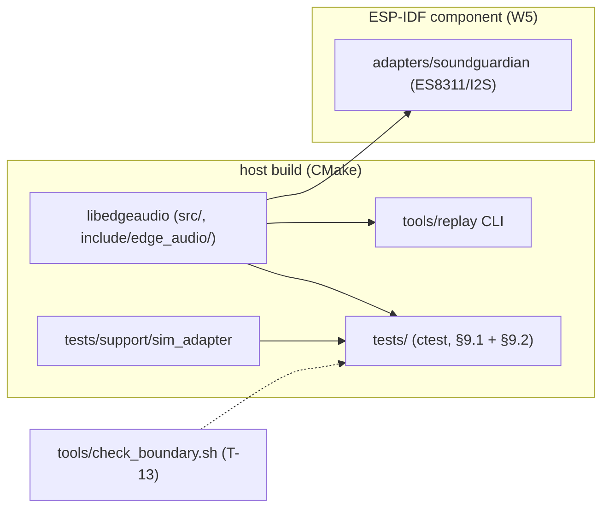

# Implementation plan — edge-audio (implementing `SPEC.md` v0.5)

> - **Target:** a C library `libedgeaudio` (host static lib + ESP-IDF component) with a host
>   replay CLI and a host test suite, satisfying `SPEC.md` v0.5 (sha256
>   `ad788dc4e4f7550ee68d2a10ad8dd71f64ddd2373d137156136f0d9923bc5e8e`), reviewed READY /
>   Level 3 by `SPEC_REVIEW_REPORT.md` (v0.5 cycle, 0 open findings).
> - **Size expectation:** the spec states no size expectation; this plan budgets
>   **1,100–1,700 production code lines** (~14–19 files) plus 900–1,500 test lines and
>   80–160 non-source lines (CMake, boundary-check script, CI glue).
> - **Method:** red-green-refactor over the §9 test groups; verification apparatus (simulated
>   adapter, boundary script, §7.1 oracles) before the features they guard; `SPEC.md` never
>   edited.
> - **Wave detail documents:** omitted — every wave below is ≤ ~350 production lines and
>   executable in one sitting with §4 as the brief (the brief-not-second-spec rule).

---

## 1. Verdict

Build a **C11 core with opaque handles** as one host-first library, in seven dependency-ordered
waves: skeleton and gate rail, pure contracts and the §7.1 oracles, the capture
core/queue/event machine, the history ring, record-and-replay, the SoundGuardian ESP-IDF
adapter, then the proof wave. The three decisions that carry the plan: (1) **host-first** — every
deterministic test group (§9.1, §9.2) runs on this Mac against a simulated adapter, so the
target toolchain is needed only for W5–W6; (2) **apparatus first** — the simulated adapter, the
adapter-boundary checker (T-13) and the §7.1 flag oracles land before the code they measure;
(3) **single loss funnel** — every drop path terminates in one episode-closing function, making
the F-013 class of silent loss structurally impossible. The plan refuses to guess the
CommonGround profile (O-2/R-09/T-16 stay deferred per D-10) and refuses to let host tests
certify target constraints (K-01/K-02/K-03 stay *verification pending* without a device).
Expected landing: **~1,400 production code lines**; dropping the replay CLI (R-08/T-04 —
a named subsystem, not offered) would fit in ~250 fewer.

## 2. What the evidence says (this is not a greenfield guess about a prior build — there is none)

No prior implementation of this spec exists. Measured facts about the starting tree and
environment (commit `a3fb121`):

| Artifact | Measured |
| --- | --- |
| Tree | `README.md` (720 B), `SPEC.md` (36,240 B), `SPEC_REVIEW_REPORT.md`, `.github/workflows/` — **no `src/`, no `tests/`, no build system** |
| Spec graph | `speccheck check`: 57 ids, 0 dangling, 0 stale; 154 edges (53 `depends_on`, 42 `verifies`, 59 `affects`) |
| Wave-boundary check | `speccheck impact --changed C-01,C-06,K-05,K-06 --depth 0`: 4 changed → 14 impacted, 12 to re-verify — the contracts slice is upstream of nearly everything, confirming it as the first pure wave |
| Host toolchain | Apple clang 21.0.0, CMake 4.3.2, ninja — present |
| Target toolchain | `idf.py` **not installed**; no M5StickS3 attached |
| Measurement tool | `cloc` not installed — the build report measures with `brew install cloc` then `cloc --quiet src include adapters tools` (tests separately) |

Systemic risks the evidence exposes: the spec's own review history shows the failure family
this system breeds is **silent loss at lifecycle edges** (F-013: an overflow episode open at
`stop()`; F-014: `close()` from `RUNNING`) — the plan's rules target exactly that; and the
environment shows the **target half cannot be verified here** (no idf.py, no device), so the
plan must name stand-ins and a downgrade rule now, not at W6.

## 3. Shape

- **Why this split is mandated:** §10 requires the deterministic groups to run on a host with
  no hardware (T-01..T-15, T-18 via the simulated adapter), C-05/I-006 require the adapter to
  be the only per-platform part (its own component), and R-08 requires a host replay tool.
- **Literal filenames** (ownership table — one wave creates each file; later waves never edit
  another wave's files):

| Path | Owner |
| --- | --- |
| `CMakeLists.txt`, `tools/check_boundary.sh`, `tests/support/test.h` | W0 |
| `include/edge_audio/types.h`, `include/edge_audio/edge_audio.h`, `src/flags.c`, `src/config.c` | W1 |
| `src/stream.c`, `src/queue.c`, `src/events.c`, `tests/support/sim_adapter.{h,c}` | W2 |
| `src/history.c` | W3 |
| `tools/replay/replay.c`, `tests/support/recorder.{h,c}` | W4 |
| `adapters/soundguardian/` (component + `es8311_i2s.c`) | W5 |
| `README.md` (rewrite), `SPEC_BUILD_REPORT.md` | W6 |

- **Purity rule:** nothing outside `adapters/` and the optional `wall_clock` setter may read a
  clock (`gettimeofday`, `clock_gettime`, `esp_timer*`) or any hardware header — enforced by
  `tools/check_boundary.sh` from W0 (I-006, R-07, F-008's wall-clock ban).
- **Layer direction:** `types.h` → {flags, config} → {queue, events, history} → stream →
  {replay tool, adapters, tests}. No cycles; the core never includes adapter or test headers.
- **Visual oracle:** n/a — the spec has no rendered surface and §9 says so; the "look at it"
  stand-in for this system is the W6 soak/replay artifact inspection named in §6.

## 4. Order (waves; each ends at a gate, not at a file count)

1. **W0 Skeleton and gate rail** — CMake host build (`-Wall -Wextra -Werror`, C11), ctest
   wiring, `tests/support/test.h` assert macros, `tools/check_boundary.sh` registered as a
   test, empty-but-linking `libedgeaudio`, CI workflow updated to run the gate.
   Gate: `cmake -B build -G Ninja && cmake --build build && ctest --test-dir build` —
   expected exit 0 (placeholder test + boundary check green). Discharges: apparatus for
   T-13/I-006; the runnable-artifact rule.
2. **W1 Contracts and oracles (pure)** — `types.h` (C-01 `AudioFrame`, C-04 `Event` +
   per-kind `detail`, C-06 `StreamConfig`, C-07 `StreamInfo`, E-02/E-04/E-09 error
   categories), §7.1 flag computation in `flags.c` (K-05), config validation in `config.c`
   (E-04 incl. K-06 integrality), C-01 index algebra helpers.
   Gate: `ctest -R 'flags|config'` — expected exit 0 with T-06 and T-07 asserted.
   Discharges: C-01, C-06, K-05, K-06, E-04; T-06, T-07.
   *The speccheck impact check in §2 confirms this boundary: these ids are upstream of 14
   others, so they must exist before any stateful code.*
3. **W2 Capture core, queue, events, lifecycle** — `sim_adapter` first (apparatus for every
   later test: scripted blocks, gap injection, fault injection), then `queue.c` (C-02, E-01,
   K-04 episodes via the single loss funnel), `events.c` (C-04, E-08 `events_dropped`),
   `stream.c` (§3.1 machine + §5.1 validity matrix, E-03/D-09 clock advance, E-05, E-06,
   E-09, C-07 query, R-10).
   Gate: `ctest -R unit` — expected exit 0 with T-01, T-02, T-03 (both fixtures), T-08 (every
   matrix cell), T-09, T-10, T-11, T-14, T-18 asserted. Discharges: R-01..R-03, R-05, R-10,
   R-11, C-02, C-04, C-07, I-001..I-003, K-04, E-01, E-03, E-05, E-06, E-08, E-09.
4. **W3 History ring (O-1)** — `history.c`: exact-interval reads, `SPANS_GAP`, oldest-first
   eviction, stale-`stream_id` → `NEVER_CAPTURED`, non-blocking writes.
   Gate: `ctest -R history` — expected exit 0 with T-05 and T-12 asserted.
   Discharges: R-04, C-03, I-004, E-02, E-07.
5. **W4 Record and replay + integration** — `recorder` test-support (the consumer artifact of
   §3.3), `tools/replay` CLI positioning windows by `first_sample_index` only, `SPANS_GAP` on
   gap-overlapping windows; the T-15 stalled-consumer thread test.
   Gate: `ctest -R 'integration|replay'` — expected exit 0 with T-04 (three windows, bit-exact,
   gap window refused) and T-15 asserted. Discharges: R-07, R-08, I-005; T-04, T-15.
6. **W5 SoundGuardian adapter** — `adapters/soundguardian/`: ESP-IDF component, ES8311/I2S
   bring-up, DMA-counter gap reports (C-05), SRAM placement for hot buffers / PSRAM for
   history (K-02), 16 kHz mono PCM_S16LE profile validation (K-01).
   Gate: `idf.py build` in `adapters/soundguardian/example/` — expected exit 0.
   Prerequisite: ESP-IDF ≥ v5.1 (`idf.py --version`); **not installed here** — stand-in
   below (§6). T-13 now runs against real adapter sources. Discharges: R-06 fully, C-05,
   I-006, K-01 (config side).
7. **W6 Prove it** — 4-hour host soak rehearsal (simulated adapter) writing the soak fields;
   the hardware soak T-17 on an M5StickS3 (recorded); `README.md` rewritten from the built
   surface; the §11 walk filling "where realized"; `speccheck check --spec SPEC.md
   --src src,include,adapters,tools --tests tests --results build/junit.xml` — expected: no
   UNCITED ids; `SPEC_BUILD_REPORT.md` with the downgrade rule applied.
   Discharges: K-03, T-17 (or records it pending), R-09/T-16 recorded as deferred per D-10.

## 5. LOC budget (production code lines, excludes vendored code — none is planned)

| Slice | Files | LOC |
| --- | --- | --- |
| Public headers + types (W1) | 2 | 120–190 |
| Flags oracle + config validation (W1) | 2 | 90–150 |
| Queue + events (W2) | 2 | 160–240 |
| Stream lifecycle + clock (W2) | 1 | 220–320 |
| History ring (W3) | 1 | 120–200 |
| Replay CLI (W4) | 1–2 | 150–250 |
| SoundGuardian adapter (W5) | 3–4 | 240–350 |
| **Total** | **~12–14** | **1,100–1,700** |
| Tests + sim adapter + recorder (separate; not "the program") | 8–12 | 900–1,500 |
| CMake, boundary script, CI glue | — | 80–160 |

Anchors: no prior build of this spec exists (no smallest-complete-build anchor — stated, not
hidden), so each row is anchored on measured comparables of the same shape: a bounded SPSC
ring queue with drop accounting runs 100–150 code lines in typical C implementations; ESP-IDF's
own `i2s_recorder` example plus ES8311 codec init is 200–300; a four-state machine with an
explicit validity matrix is ~200–300 with the E-09 plumbing. Rules: if a slice approaches its
ceiling, decompose it (split `stream.c`) — never drop a subsystem to fit; and the budget is a
ceiling and an estimate, never a floor — a smaller complete landing loses nothing unless the
§11 walk says so.

## 6. Rules that make the observed failures impossible

| Observed failure (evidence) | Structural rule |
| --- | --- |
| Silent loss at lifecycle edges — the spec's own review cycle caught an episode open at `stop()` never emitting (F-013) and `close()`-from-`RUNNING` undefined (F-014) | **Single loss funnel:** every drop site calls one `episode_close()` in `queue.c`; `stop()`/fault/`close()` paths call it before the transition returns. Checked by T-03's mid-episode fixture and by `check_boundary.sh` grepping that no `drop`/`overflow` symbol exists outside `queue.c`. |
| Wall-clock creep into timing (R-07's ban; F-008 forbade wall-clock gap derivation) | `check_boundary.sh` fails the build if `gettimeofday`/`clock_gettime`/`esp_timer` appear outside `adapters/` — running from W0, so the rule precedes every feature. |
| Hardware coupling leaking past the adapter (I-006 — the v0.1 spec's core motivation) | T-13 is a registered ctest from W0; `src/` and `include/` compile in the host build with no ESP-IDF include path available, so a leak is a compile error, not a review comment. |
| Self-certified target constraints — no idf.py, no device on this host (measured, §2) | Host tests may never mark K-01/K-02/K-03/T-17 as passed. The report's soak row requires two artifacts: the ESP-IDF map file showing placement (K-02) and the device soak log (K-03). Absent either, the row is *verification pending* and the verdict cannot say PASS for those ids. |
| Budget-as-target (the worked-example failure in this skill) | §5's numbers are ceilings; no wave pads to meet a row; the W6 report records measured `cloc` output against the budget without treating under-landing as a defect. |

**Live verification (W6).** The surface only provable by running the real thing is the
capture path on hardware. Exact drive: flash the W5 example to an M5StickS3, run 4 hours
(K-03), collect the device log (event stream, starvation counters) and the `idf.py size`/map
artifacts, then replay a recorded window on the host and inspect the replay tool's output
against the recording (`tools/replay --window <a>,<n>` — expected: bit-exact bytes, `SPANS_GAP`
on a gap window).

- **Prerequisites, named now:** ESP-IDF ≥ v5.1 installed (`idf.py --version` succeeds); an
  M5StickS3 on USB (`ls /dev/cu.usbmodem*`); 4 uninterrupted hours. None of these exists in
  this environment today (measured, §2).
- **Stand-in for each:** without idf.py — build the adapter sources on host behind
  `EDGE_AUDIO_TARGET_STUBS` (compile-only, covers syntax and I-006, covers nothing about
  placement or timing); without the device — the 4-hour **host** soak with the simulated
  adapter (covers I-003/K-03's starvation logic, not K-01/K-02 hardware behavior). Each
  stand-in's coverage and non-coverage is written into the report row it touches.
- **Downgrade rule:** what the stand-ins cannot reach — K-02 placement, T-17's device soak —
  stays *verification pending* in `SPEC_BUILD_REPORT.md` and blocks a PASS verdict for those
  ids; the report's overall verdict is then CONFORMING (host groups) / PENDING (target soak),
  never PASS.

## 7. One fork, then action

**Core language dialect: C11 with opaque handles — SETTLED by the integrator (2026-09-27):
C11 with opaque handles.** D-01 pinned
"C/C++" without choosing; the plan must. C11 is recommended because the target half is an
ESP-IDF component on a 512 KB-SRAM part where C is the native idiom (no exception/RTTI
machinery to disable, no ABI seam at the component boundary), the contracts are plain data
(C-01..C-07 are structs and enums), and a single dialect serves host tests and target
unchanged. The alternative — C++17 with RAII handles — buys destructor-enforced `close()` and
namespaced enums, and costs `-fno-exceptions -fno-rtti` discipline on target, an `extern "C"`
seam for the component API, and a second idiom in an otherwise C ecosystem. **What stays true
on both branches:** the wave order, the gates, the budgets (±10 %), and every rule in §6 — the
fork changes file suffixes and handle style, nothing structural.

**Next concrete action (W0):** `cmake -B build -G Ninja && cmake --build build && ctest
--test-dir build` against the new skeleton — done when it exits 0 on this host with the
placeholder test and `check_boundary.sh` both green, and the same command runs in CI.
