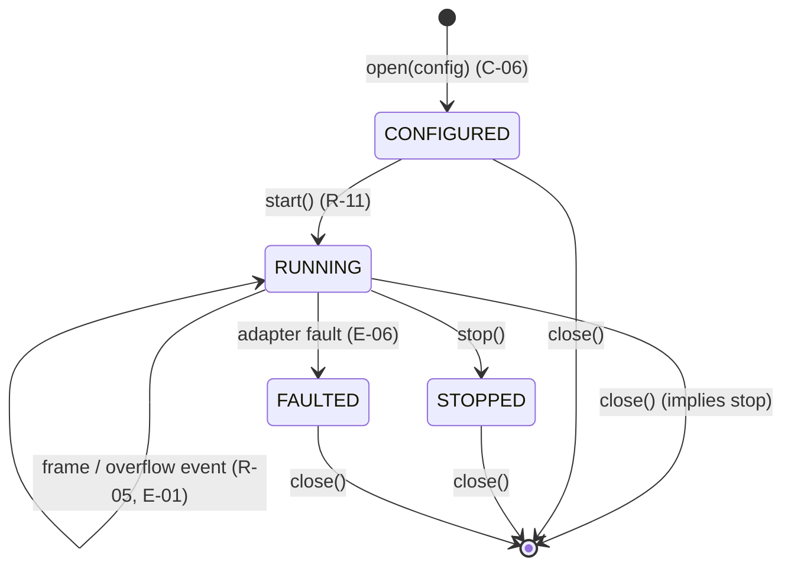
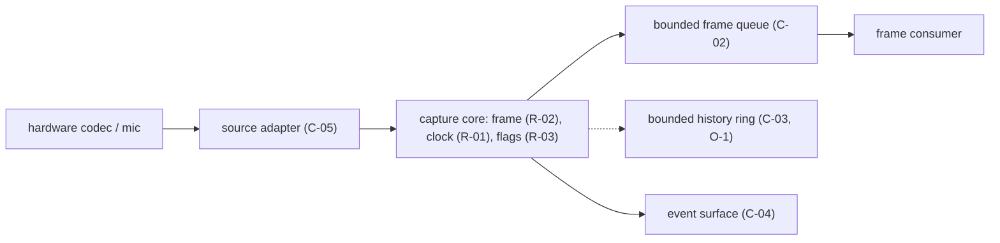

# SPECIFICATION — edge-audio (audio ingest, PCM capture, sample-clock, bounded history; embedded library)

> - **Status:** v0.5 — all decisions D-01..D-15 ratified (§12); review findings F-001..F-016 resolved
> - **Language / stack:** C/C++ single binding — ESP-IDF target build (ESP32-S3) + POSIX host build for tests and replay (D-01) | surface: library API
> - **Sources:** prior prose `SPEC.md` (v0.1, commit 1d23c74); `README.md` (repository role); SoundGuardian spec ids transferred here — `sg:C-06`, `sg:C-07`, audio side of `sg:C-13`, `sg:C-14`, audio-history side of `sg:C-26`, and the sample-count-clock rule introduced in SoundGuardian v0.8; `SPEC_REVIEW_REPORT.md` (review of v0.3, findings F-001..F-012)
> - **Scope of this document:** the platform-independent audio-ingest boundary — frame contract, sample clock, queues, bounded history, and evidence flags. It does not own detector logic, ASR, product policy, or hardware bring-up beyond the adapter boundary (§0 non-goals).
> - **Normative language:** MUST/MUST NOT/SHALL/SHALL NOT = normative; SHOULD = strong recommendation; MAY = optional.
> - **Principle:** capture is deterministic and never waits — the sample-count clock is the single source of timing truth, and every loss of data is explicit.

---

## 0. Intent and purpose

edge-audio is a platform-independent, deterministic audio-ingest boundary for systems that
need bounded, replayable acoustic evidence. SoundGuardian uses it for TV audio capture,
detector input, and acoustic mute observation. CommonGround uses it ahead of VAD/ASR/
addressability (its profile is deferred per D-10 until the appliance hardware is settled).

The component sits on the **deterministic side** of a deterministic ↔ probabilistic boundary:
everything downstream of the frame queue (detectors, VAD, ASR, classification) is
probabilistic and out of scope; everything this spec owns — frame production, the sample
clock, queues, history — is deterministic and replayable. edge-audio owns the deterministic
side; the consuming product owns the probabilistic side.

**Relationship to SoundGuardian:** this repository extracts and now owns the SoundGuardian
contracts listed in the front-matter Sources. SoundGuardian consumes this spec's contracts and
MUST NOT redefine them. The transferred ownership maps as: `sg:C-06` → C-01 (frame contract),
`sg:C-07` → C-02 (frame queue), audio side of `sg:C-13` and `sg:C-14` → C-04 (events),
audio-history side of `sg:C-26` → C-03 (history read), SoundGuardian v0.8 sample-count-clock
rule → R-01/R-07.

**Non-goals:**

- No commercial classification.
- No ASR semantics.
- No action authorization.
- No network, UI, or flash work on the real-time capture path.

## 1. Actors and goals

| Actor | Goals |
| ----- | ----- |
| **Source adapter** (`adapter`) | Owns hardware/codec specifics (e.g. ES8311/I2S, ALSA); produces raw samples into the capture path; trusted, in-process |
| **Capture core** (`capture`) | Turns raw samples into canonical `AudioFrame`s (C-01), maintains the sample clock, sets evidence flags, feeds the frame queue (C-02) |
| **Frame consumer** (`consumer`) | A product pipeline (detector, VAD/ASR front-end) that drains the frame queue; may be slower than capture and must never stall it |
| **History reader** (`history`) | Reads bounded audio history by exact sample interval (C-03) for evidence extraction |
| **Host replay tool** (`replay`) | Offline process that reproduces sample windows from recorded frames (R-08); runs on a development host, not the device |
| **Operator / integrator** | Configures a platform profile (§7), consumes overflow and discontinuity events (C-04) for diagnostics |

## 2. Requirements (intent, high level)

| ID | Statement |
| -- | --------- |
| **R-01** | The capture core MUST produce monotonic PCM frames carrying an explicit sample-count clock: each frame's `first_sample_index` per C-01. *(Source: v0.1 "Owned behavior"; SoundGuardian v0.8 sample-count-clock rule.)* |
| **R-02** | The source adapter MUST deliver sample blocks already in PCM_S16LE at the stream's configured rate and channel count (C-05); the capture core MUST NOT perform sample-value conversion — its normalization is limited to framing and interleaving layout (C-01). Consumers MUST NOT receive adapter-native block shapes. *(Source: v0.1 "Owned behavior"; F-009/D-13.)* |
| **R-03** | The capture core MUST report clipping, silence/level evidence, and discontinuities via the per-frame flags in C-01, computed per the formulas in §7.1. *(Source: v0.1 "Owned behavior".)* |
| **R-04** | The component MAY maintain bounded audio history (O-1); when enabled, history writes MUST NOT block or delay the capture path (I-003). *(Source: v0.1 "Owned behavior".)* |
| **R-05** | All queues between capture and consumers MUST be bounded; overflow MUST be surfaced as a structured event (C-04) and MUST NOT silently discard data without one. *(Source: v0.1 "Owned behavior", "Acceptance".)* |
| **R-06** | Hardware-specific codec/I2S/microphone details MUST stay behind the source-adapter boundary (C-05); no code outside the adapter may reference them. *(Source: v0.1 "Owned behavior".)* |
| **R-07** | `first_sample_index` is authoritative for timing. Wall-clock timestamps, when present, are metadata and MUST NOT drive deterministic replay decisions. *(Source: v0.1 "Canonical frame contract".)* |
| **R-08** | A host replay tool MUST be able to reproduce any recorded sample window bit-exactly from recorded frames (T-04). A window overlapping an uncaptured index MUST be reported as spanning a gap (`SPANS_GAP`, C-03, D-14) — never zero-filled or truncated. *(Source: v0.1 "Acceptance"; F-004.)* |
| **R-09** | *(Deferred per D-10 with O-2.)* In the CommonGround profile (O-2), adapter-side transforms (beamforming/AEC/VAD) whose outputs become replay inputs MUST be explicitly versioned in the stream's `StreamInfo` metadata (C-07). Not required for conformance while D-10 defers O-2. *(Source: v0.1 "Platform profiles"; F-002/F-003.)* |
| **R-10** | Diagnostics: every drop, overflow, discontinuity, and adapter fault MUST be observable through the event surface (C-04); the capture path MUST NOT log raw audio payloads. *(Cross-cutting; derived from v0.1 invariants and non-goals.)* |
| **R-11** | Configuration: sample rate, channel count, queue depth, and history capacity MUST be fixed at stream-open time (C-06) and MUST NOT change while a stream is `RUNNING`. Frame duration is pinned by K-06, not configured. *(Derived; see D-02, D-03, D-07.)* |

## 3. Behavior and state model

### 3.1 Stream lifecycle

A stream is one continuous capture session with one sample clock.

| From | To | Trigger |
| ---- | -- | ------- |
| — | `CONFIGURED` | `open(config)` accepted (C-06) |
| `CONFIGURED` | `RUNNING` | `start()`; sample clock begins at index $0$ |
| `RUNNING` | `RUNNING` | frame produced; overflow (E-01) or adapter underrun (E-03) sets flags/events but does not change state |
| `RUNNING` | `STOPPED` | `stop()`; no further frames are produced; queued frames remain drainable (§5.1) |
| `RUNNING` | `FAULTED` | unrecoverable adapter fault (E-06) |
| `RUNNING` | closed | `close()`; implies `stop()` first — any open overflow episode emits its event (K-04) — then all resources released |
| `CONFIGURED`, `STOPPED`, `FAULTED` | closed | `close()`; all resources released |



*Figure 3.1 — stream lifecycle per R-11, R-05, E-01, E-06. The table above is normative; the
diagram is illustrative.*

A new stream after `close()` gets a fresh `stream_id` and a sample clock restarting at $0$
(E-07). There is no resume: sample indices never continue across streams.

### 3.2 Capture flow



*Figure 3.2 — capture path per R-01..R-05; the dotted edge is the optional history write
(O-1), which is non-blocking per I-003.*

### 3.3 Durable artifacts

The component itself persists nothing. Recorded frame streams written by a consumer (for
replay per R-08) are the consumer's artifacts; their replayability is guaranteed by C-01 and
I-001/I-005, not by any storage format this spec pins. Raw audio remains ephemeral by default
at the product level (O-2).

## 4. Interfaces / contracts

### C-01 — Canonical audio frame

```text
AudioFrame {
  stream_id          : opaque identifier, constant for the life of one stream;
                       unique within one device boot (a monotonic counter suffices);
                       cross-reboot reuse is permitted and is disambiguated by the
                       consumer's recording context
  first_sample_index : uint64        # index of samples[0] within the stream, per channel frame
  sample_rate_hz     : uint32        # fixed per stream (R-11)
  channels           : uint8         # fixed per stream (R-11)
  format             : PCM_S16LE (the only format; D-08 confirmed)
  samples[]          : interleaved int16 samples; length > 0 (E-05); per-channel count per K-06
  flags {
    discontinuity    : bool          # samples were lost immediately before this frame (I-002)
    clipped          : bool          # per §7.1 clipping rule
    silent           : bool          # per §7.1 silence rule
  }
  wall_clock         : optional metadata; never authoritative (R-07)
}
```

Required fields: all except `wall_clock`. `first_sample_index` counts sample *frames* (one
per channel set), not individual interleaved values. For consecutive frames $n$ and $n+1$ of
the same stream with no loss, $\mathrm{first\_sample\_index}_{n+1} =
\mathrm{first\_sample\_index}_n + N_n$ where $N_n$ is frame $n$'s per-channel sample count;
any other positive gap requires `discontinuity = true` on frame $n+1$ (I-001, I-002).

### C-02 — Frame queue

```text
FrameQueue {
  capacity : fixed at open (D-03)
  push     : capture-side, non-blocking; when the queue is full, the oldest
             frame(s) are dropped (drop-oldest, D-03); the episode rule in K-04
             governs the single QUEUE_OVERFLOW event (C-04), and the next
             delivered frame carries discontinuity=true
  pop      : consumer-side, non-blocking poll; returns a frame, `empty`, or
             `end_of_stream` per the §5.1 result rule; never affects capture timing
}
```

Ordering: frames are delivered in strictly increasing `first_sample_index` order (I-001).
Idempotency: a frame is delivered at most once.

### C-03 — Bounded history read

```text
HistoryRead {
  request  : (stream_id, first_sample_index, sample_count)
  response : exactly the requested interval, bit-identical to the captured samples
           | UNAVAILABLE { reason: EVICTED | NEVER_CAPTURED | OUT_OF_RANGE | SPANS_GAP }
}
```

Partial results MUST NOT be returned: the response is the exact interval or an explicit
`UNAVAILABLE` (I-004, E-02). An interval that overlaps any sample index that was never
captured (a gap per E-01/E-03) is `UNAVAILABLE { reason: SPANS_GAP }` even when every other
index in it is held (D-14). A request whose `stream_id` does not match the handle's current
stream is `UNAVAILABLE { reason: NEVER_CAPTURED }` (E-07). History capacity is fixed at open
(D-07); eviction is oldest-first.

### C-04 — Structured event

```text
Event {
  stream_id
  kind           : QUEUE_OVERFLOW | DISCONTINUITY | ADAPTER_FAULT
  at_sample      : uint64   # per-kind definition below (R-07)
  events_dropped : uint32   # events lost from the event queue since the last
                            # delivered event; 0 in normal operation (E-08)
  detail         : per-kind payload, below
}
```

Per-kind semantics:

| Kind | `at_sample` | `detail` |
| ---- | ----------- | -------- |
| `QUEUE_OVERFLOW` | `first_sample_index` of the oldest dropped frame in the episode | `{ frames_dropped : uint32 }` — the episode total (K-04, D-15) |
| `DISCONTINUITY` | first lost sample index | `{ gap_samples : uint64 }` — as reported by the adapter (C-05, E-03) |
| `ADAPTER_FAULT` | the next index the clock would have assigned when the fault was detected | `{ code : opaque adapter-defined value }` |

Clipping and silence evidence is carried only by the per-frame flags (R-03); there are no
clip/silence event kinds (D-12).

Events are the sole diagnostics surface for loss and faults (R-10). Event emission MUST NOT
block capture (I-003); the event queue is itself bounded, and its overflow is counted, not
hidden (E-08).

### C-05 — Source adapter boundary

```text
SourceAdapter {
  provides : sample blocks already in PCM_S16LE at the stream's configured
             sample_rate_hz and channels (R-02, D-13), plus an explicit gap
             report (gap_samples : uint64) for every hardware loss, derived
             from hardware/DMA counters — never from wall clock (E-03, D-09)
  owns     : codec registers, I2S/DMA configuration, microphone topology, any
             internal conversion to the canonical format, and optional
             front-end transforms (O-2, R-09 — deferred per D-10)
  must not : expose hardware types/headers across the component boundary (R-06)
}
```

The adapter is the only replaceable per-platform part; two builds differing only in adapter
MUST be indistinguishable to consumers except for `sample_rate_hz`/`channels` values.

### C-06 — Stream configuration

```text
StreamConfig {
  sample_rate_hz   : uint32   (profile-constrained, §7)
  channels         : uint8
  queue_capacity   : frames (D-03)
  history_capacity : samples per channel, 0 = history disabled (O-1, D-07)
}
```

Format is not configurable — it is always PCM_S16LE (C-01, D-08). Frame duration is not
configurable — it is pinned at 20 ms by K-06 (D-02).

Invalid configurations are rejected at `open` (E-04); nothing is captured for a rejected open.

### C-07 — Stream metadata

```text
StreamInfo {
  stream_id          : per C-01
  sample_rate_hz     : uint32   # as configured (C-06)
  channels           : uint8    # as configured (C-06)
  format             : PCM_S16LE
  transform_versions : list of (name, version) string pairs; empty when no
                       replay-relevant front-end transform is active (R-09);
                       always empty on the SoundGuardian profile (K-01)
}
```

`StreamInfo` is queryable from the handle in every state after `open` (§5.1) and is constant
for the life of the stream (D-11). Consumers that record frame streams for replay SHOULD
record the stream's `StreamInfo` beside them (R-08, R-09).

## 5. Interface specification

The component has one surface: a **library API**. There is no CLI, GUI, or network surface, so
no operations table for those and no observed test group (§9).

### 5.1 Library API operations

| Operation | Inputs | Outputs | Errors | Notes |
| --------- | ------ | ------- | ------ | ----- |
| `open` | `StreamConfig` (C-06) | stream handle, state `CONFIGURED` | invalid config → E-04 rejection | validates against active profile (§7) |
| `start` | handle | state `RUNNING`; sample clock at $0$ | wrong state → E-09 | |
| `pop` / consume | handle | next `AudioFrame` (C-01), `empty`, or `end_of_stream` | invalid state → E-09 | `empty` = queue momentarily empty while `RUNNING`; `end_of_stream` = queue drained in `STOPPED`/`FAULTED` (E-06); never blocks capture (I-003) |
| `read_history` | `HistoryRead` request (C-03) | exact interval or `UNAVAILABLE` | E-02; invalid state → E-09 | only when `history_capacity > 0` |
| `poll_events` | handle | zero or more `Event`s (C-04) | invalid state → E-09 | |
| `stream_info` | handle | `StreamInfo` (C-07) | invalid state → E-09 | constant per stream |
| `stop` | handle | state `STOPPED`; queue drainable | invalid state → E-09 | |
| `close` | handle | resources released | — | valid from any state; from `RUNNING`, implies `stop()` first (§3.1, K-04) |

Operation validity by state — E-09 applies outside the ✓ cells; `open` precedes any handle
and `close` is valid in every state, so both are omitted:

| Operation | `CONFIGURED` | `RUNNING` | `STOPPED` | `FAULTED` |
| --------- | ------------ | --------- | --------- | --------- |
| `start` | ✓ | — | — | — |
| `pop` | — | ✓ | ✓ (drain) | ✓ (drain) |
| `read_history` | — | ✓ | ✓ | ✓ |
| `poll_events` | ✓ | ✓ | ✓ | ✓ |
| `stream_info` | ✓ | ✓ | ✓ | ✓ |
| `stop` | — | ✓ | — | — |

### 5.2 Cross-cutting contract — diagnostics and errors

Quiet by default: a healthy stream emits no events. Every loss or fault is exactly one event
kind (C-04). Raw audio payloads are never written to any log or event (R-10). Error reporting
from operations uses the binding's native mechanism (status code, exception, `Result`) but the
error *categories* are fixed by E-02, E-04, E-09.

## 6. Invariants (must hold in every valid implementation)

| ID | Invariant |
| -- | --------- |
| **I-001** | Within a stream, `first_sample_index` is strictly increasing across delivered frames; it never moves backward or repeats. |
| **I-002** | Every dropped or lost sample interval is announced: the next delivered frame carries `discontinuity = true`, and a `DISCONTINUITY` or `QUEUE_OVERFLOW` event announces the loss no later than the end of its episode (K-04). Loss is never silently hidden. |
| **I-003** | The capture path never waits on inference, UI, network, logging, storage, history writes, or event delivery. |
| **I-004** | A bounded-history read returns the exact sample interval requested, bit-identical, or an explicit `UNAVAILABLE` — never a partial or approximated result. |
| **I-005** | Given identical recorded frame streams, replay is deterministic: the same sample windows are reproduced bit-exactly on any host (R-08). |
| **I-006** | No code outside the source adapter references hardware-specific types, registers, or headers (R-06). |

## 7. Constraints (precise and measurable)

| ID | Constraint |
| -- | ---------- |
| **K-01** | SoundGuardian / M5StickS3 profile: `sample_rate_hz` = 16000, `channels` = 1, `format` = PCM_S16LE. The source adapter owns ES8311/I2S details. |
| **K-02** | On the SoundGuardian profile (K-01), DMA buffers and hot queues MUST reside in internal SRAM; only larger rolling history MAY use PSRAM. |
| **K-03** | Soak: a stream MUST run $\geq$ 4 hours (D-04) with zero capture starvation (no adapter-side sample loss caused by this component) and zero unannounced discontinuities. |
| **K-04** | Queue overflow is drop-oldest (D-03). An overflow *episode* begins with the first push that drops after a push that did not, and ends at the next push that does not drop; exactly one `QUEUE_OVERFLOW` event is emitted, at episode end, carrying the episode's total `frames_dropped` (D-15). A `stop()` or adapter fault while an episode is open also ends the episode, and its event MUST be emitted before the state transition completes. |
| **K-05** | Clipping and silence flag thresholds per §7.1: clipping at full-scale sample magnitude; silence at $L_{\mathrm{dBFS}} < -60$ (D-05, D-06). |
| **K-06** | Frame duration is 20 ms for every stream (D-02): the per-channel sample count is $0.02 \cdot \mathrm{sample\_rate\_hz}$ — 320 samples at 16 kHz (K-01). A `sample_rate_hz` for which $0.02 \cdot \mathrm{sample\_rate\_hz}$ is not an integer is an invalid configuration (E-04). |

### 7.1 Level, silence, and clipping formulas

For a frame with per-channel sample count $N > 0$ and normalized samples
$x_i \in [-1, 1]$ (for PCM_S16LE, $x_i = s_i / 32768$ over all interleaved samples,
population = the whole frame):

$$
\begin{aligned}
L_{\mathrm{rms}} &= \sqrt{\frac{1}{N \cdot C}\sum_{i=1}^{N \cdot C} x_i^2} \\
L_{\mathrm{dBFS}} &= 20 \log_{10} L_{\mathrm{rms}}
\end{aligned}
$$

where $C$ is the channel count. `silent = true` iff $L_{\mathrm{dBFS}} < -60$ dBFS
(units: dB relative to full scale). `clipped = true` iff any raw sample equals the format's
extreme values ($-32768$ or $32767$ for PCM_S16LE). Degenerate case: $N = 0$ cannot occur
(frames are non-empty per C-01/E-05); if $L_{\mathrm{rms}} = 0$, $L_{\mathrm{dBFS}}$ is
$-\infty$ and the frame is silent.

### 7.2 Optional items

| ID | Item | Gate | Status |
| -- | ---- | ---- | ------ |
| **O-1** | Bounded audio history (C-03): non-blocking ring writes on the capture path, exact-interval reads | `history_capacity > 0` at `open` (C-06) | active |
| **O-2** | CommonGround profile: appliance adapter with front-end transforms, versioned per R-09/C-07 and tested by T-16 | no profile K row exists yet | deferred per D-10 |

## 8. Edge cases and failure semantics

| ID | Case | Semantics |
| -- | ---- | --------- |
| **E-01** | Frame queue full when capture pushes | Oldest frame(s) dropped (K-04); one `QUEUE_OVERFLOW` event per episode; next delivered frame has `discontinuity = true`. Capture never blocks. |
| **E-02** | History read for an evicted, never-captured, out-of-range, or gap-spanning interval | `UNAVAILABLE` with reason `EVICTED`, `NEVER_CAPTURED`, `OUT_OF_RANGE`, or `SPANS_GAP` (an interval overlapping any uncaptured index, D-14); no partial data. |
| **E-03** | Adapter underrun/overrun (hardware lost samples) | Next frame carries `discontinuity = true`; `DISCONTINUITY` event with the gap's `at_sample` and the adapter-reported `gap_samples` (C-04, C-05); the sample clock advances by the adapter-reported gap so the clock stays aligned to real capture time (D-09). |
| **E-04** | Invalid `StreamConfig` at `open` (unsupported rate, rate failing K-06 integrality, zero channels, profile violation) | `open` is rejected with a category-`INVALID_CONFIG` error; no stream exists; no resources retained. |
| **E-05** | Adapter delivers an empty sample block | Discarded by the capture core; no frame is produced; no clock advance. |
| **E-06** | Unrecoverable adapter fault while `RUNNING` | Stream enters `FAULTED`; `ADAPTER_FAULT` event; already-queued frames remain drainable; further `pop` after drain reports end-of-stream. |
| **E-07** | Stream restart after `close` | New `stream_id`; sample clock restarts at $0$; history from the prior stream is not readable. |
| **E-08** | Event queue itself overflows | Oldest events dropped; the drop count is reported as the next delivered event's `events_dropped` field (C-04); capture is unaffected (I-003). |
| **E-09** | Operation called in wrong state (e.g. `start` while `RUNNING`) | Rejected with a category-`INVALID_STATE` error; stream state unchanged. |

## 9. Acceptance criteria, tests, and evals

No rendered surface exists, so there is no observed test group (§5); conformance is fully
scriptable plus one recorded soak run.

### 9.1 Unit (fast, deterministic)

| ID | Test |
| -- | ---- |
| **T-01** | Feed synthetic adapter blocks; assert every delivered frame satisfies the C-01 shape, the K-06 per-channel sample count, and the index equation in C-01 (proves R-01, R-02, I-001, K-06). |
| **T-02** | Inject a simulated adapter gap with a known size; assert the next frame has `discontinuity = true` and a `DISCONTINUITY` event whose `at_sample` is the first lost index and whose `gap_samples` equals the injected size (C-04) (proves I-002, E-03). |
| **T-03** | Fill the queue past capacity; assert drop-oldest, exactly one `QUEUE_OVERFLOW` event with the episode's total `frames_dropped` emitted at episode end, and `discontinuity = true` on the next delivered frame; a second fixture calls `stop()` mid-episode and asserts the event is emitted before the stream reaches `STOPPED` (proves R-05, K-04, E-01). |
| **T-05** | History: write then read an exact interval → bit-identical samples; read an evicted, an out-of-range, and a gap-spanning interval → `UNAVAILABLE` with the correct reason, including `SPANS_GAP` (proves R-04, I-004, E-02). |
| **T-06** | Known fixtures for §7.1: a full-scale frame sets `clipped`; a $-70$ dBFS frame sets `silent`; a $-40$ dBFS frame sets neither (proves R-03, K-05). |
| **T-07** | Invalid configs (unsupported rate, rate failing K-06 integrality, zero channels, profile violation) are rejected at `open` with `INVALID_CONFIG`; valid config succeeds (proves R-11, E-04, K-06). |
| **T-08** | Every operation × state cell of the §5.1 validity matrix is exercised: ✓ cells succeed, — cells return `INVALID_STATE` without changing stream state (proves R-11, E-09). |
| **T-09** | Empty adapter block produces no frame and no clock advance (proves E-05). |
| **T-10** | Fault injection: adapter fault moves stream to `FAULTED`, emits `ADAPTER_FAULT`, queued frames drain, then end-of-stream (proves E-06). |
| **T-11** | Event-queue overflow drops oldest events and reports the drop count in the next event (proves E-08, R-10). |
| **T-12** | Restart after `close`: new `stream_id`, clock at $0$, and a history read citing the prior `stream_id` returns `UNAVAILABLE { NEVER_CAPTURED }` per C-03 (proves E-07). |
| **T-13** | Static check: no source file outside the adapter includes/references hardware-specific headers or symbols (grep/link-based; proves R-06, I-006). |
| **T-14** | No log or event payload contains raw audio samples, verified against a capture run's full diagnostic output (proves R-10). |
| **T-18** | `stream_info` returns the configured `sample_rate_hz`/`channels`, `PCM_S16LE`, and empty `transform_versions` on the SoundGuardian profile; the values are identical across every state the §5.1 matrix marks valid (proves C-07, R-11). |

### 9.2 Integration

| ID | Test |
| -- | ---- |
| **T-04** | Record a frame stream from a live or simulated adapter; on a host, replay tool reproduces three arbitrary sample windows bit-exactly, using only `first_sample_index` (never wall clock) for positioning; a window overlapping a recorded gap is reported `SPANS_GAP`, never zero-filled (proves R-07, R-08, I-005). |
| **T-15** | Concurrency: a consumer that stalls for 10 s while capture runs causes overflow events but zero capture-side starvation, measured via adapter-side counters (proves I-003, R-05). |
| **T-16** | *(Deferred per D-10.)* CommonGround profile with a versioned front-end transform enabled: `StreamInfo.transform_versions` (C-07) carries the transform version; replay of that stream reports the version. Not required for conformance while O-2 is deferred (proves R-09, O-2). |

### 9.3 Soak (recorded)

| ID | Test |
| -- | ---- |
| **T-17** *(recorded)* | 4-hour soak on the SoundGuardian profile (K-01..K-03): zero capture starvation, zero unannounced discontinuities (every gap has an event), memory placement verified SRAM/PSRAM per K-02. Result recorded in `SPEC_BUILD_REPORT.md` §soak; the suite carries a presence check that the recorded report exists and asserts these fields (proves K-01, K-02, K-03). |

## 10. Dependencies and environment

- **Contract dependencies:** none at the repository-contract level (per `README.md`); this
  repository is independently versioned and MAY be mounted as a Git submodule by products.
- **Runtime:** one C/C++ implementation (D-01 confirmed): ESP-IDF toolchain for the ESP32-S3
  target build; a POSIX host build (with a simulated adapter) runs the test suite and replay
  tool.
- **Test suite:** MUST run deterministic groups (§9.1, §9.2 with simulated adapter) on a
  development host with no hardware attached; T-17 alone requires target hardware.
- **Environment variables / host prerequisites:** none required by the contract; anything a
  binding adds MUST be documented in that binding's README.

## 11. Traceability matrix (id → where realized)

Component names are the §1/§4 assignments; `spec-build` fills in real modules and test files.

| Spec id | Where realized (component / module) | Verified by |
| ------- | ----------------------------------- | ----------- |
| R-01 | capture core | T-01 |
| R-02 | source adapter + capture core | T-01, T-13 |
| R-03 | capture core (flag computation) | T-06 |
| R-04 | history ring | T-05 |
| R-05 | frame queue | T-03, T-15 |
| R-06 | adapter boundary / build layout | T-13 |
| R-07 | frame contract + replay tool | T-04 |
| R-08 | replay tool | T-04 |
| R-09 | CommonGround adapter (O-2, deferred per D-10) | T-16 (deferred) |
| R-10 | event surface | T-11, T-14 |
| R-11 | stream lifecycle / config validation | T-07, T-08 |
| C-01 | frame contract | T-01 |
| C-02 | frame queue | T-03 |
| C-03 | history ring | T-05 |
| C-04 | event surface | T-02, T-03, T-11 |
| C-05 | source adapter | T-13 |
| C-06 | config validation | T-07 |
| C-07 | stream metadata | T-18 |
| I-001 | capture core (sample clock) | T-01 |
| I-002 | capture core + events | T-02, T-03 |
| I-003 | capture path design | T-15 |
| I-004 | history ring | T-05 |
| I-005 | replay tool | T-04 |
| I-006 | build layout | T-13 |
| K-01 | SoundGuardian profile config | T-07, T-17 |
| K-02 | embedded memory placement | T-17 |
| K-03 | soak | T-17 |
| K-04 | frame queue | T-03 |
| K-05 | flag computation | T-06 |
| K-06 | capture core (frame sizing) | T-01 |
| E-01 | frame queue | T-03 |
| E-02 | history ring | T-05 |
| E-03 | capture core | T-02 |
| E-04 | config validation | T-07 |
| E-05 | capture core | T-09 |
| E-06 | fault handling | T-10 |
| E-07 | lifecycle | T-12 |
| E-08 | event surface | T-11 |
| E-09 | lifecycle | T-08 |

## 12. Open questions and decisions to confirm

D-01..D-09 were ratified in v0.3, with choices biased toward minimum complexity for the two
proposed usages (soundguardian-device, commonground-device). D-10..D-13 were ratified in v0.4
while resolving the spec-review findings; D-14 and D-15 were ratified in v0.5.

| ID | Decision | Default taken | Alternatives | Affects | Owner / status |
| -- | -------- | ------------- | ------------ | ------- | -------------- |
| D-01 | Implementation language/stack | Single C/C++ implementation: ESP-IDF target build + POSIX host build for tests and replay | Rust binding; language-agnostic multi-binding (rejected: per-binding conformance cost) | R-11, C-06 | integrator / confirmed v0.3 |
| D-02 | Frame size | Pinned 20 ms frame duration (K-06); 320 samples/channel at 16 kHz; not configurable | 10 ms frames; configurable at open (rejected: extra config knob, variable-size consumers) | R-11, C-01, C-06, K-06, T-01 | integrator / confirmed v0.3 |
| D-03 | Queue overflow policy and capacity | Drop-oldest; capacity configurable at open | Drop-newest; block-with-timeout (rejected: violates I-003); pinned capacity (rejected: products need tuning room) | R-05, C-02, C-06, K-04, E-01, T-03 | integrator / confirmed v0.3 |
| D-04 | Soak duration for K-03 ("multi-hour" in v0.1) | 4 hours | 8 h; 24 h (rejected: blocks hardware rigs too long) | K-03, T-17 | integrator / confirmed v0.3 |
| D-05 | Silence threshold | Fixed $-60$ dBFS frame RMS, stateless | $-50$ dBFS; hysteresis onset/offset (rejected: stateful capture-path logic) | R-03, K-05, T-06 | integrator / confirmed v0.3 |
| D-06 | Clipping definition | Any sample at format extreme value, stateless | $\geq$ 3 consecutive extreme samples (rejected: run-length state across frame boundaries) | R-03, K-05, T-06 | integrator / confirmed v0.3 |
| D-07 | History capacity and eviction | Capacity in samples set at open, 0 disables; oldest-first eviction | Fixed per profile; time-based retention (rejected: conversion/drift logic) | R-04, C-03, C-06, E-02, T-05 | integrator / confirmed v0.3 |
| D-08 | Sample formats | PCM_S16LE is the only format; the "implementation-approved equivalent" escape hatch is removed | PCM_S32LE; float32; keep escape hatch (rejected: consumers must handle formats no device uses) | C-01, K-01, K-05, R-02, T-06 | integrator / confirmed v0.3 |
| D-09 | Sample-clock advance on adapter gaps (E-03) | Clock advances by the estimated gap so indices stay aligned to real capture time | Count delivered samples only (rejected: system-wide drift correction pushed onto every consumer) | E-03, I-001, T-02 | integrator / confirmed v0.3 |
| D-10 | CommonGround profile (O-2) scope | Deferred: O-2, R-09, T-16 are excluded from conformance until commonground-device hardware is settled | Specify a guessed profile now (rejected: rework risk); drop CommonGround entirely (rejected: loses recorded intent) | O-2, R-09, C-07, T-16 | integrator / confirmed v0.4; profile definition open |
| D-11 | Stream metadata carrier | Minimal `StreamInfo` contract (C-07) queryable from the handle; `transform_versions` empty on the SoundGuardian profile | Defer with O-2 (rejected: recordings would carry no self-describing header; un-deferring forces a contract change) | R-08, R-09, C-07, T-18 | integrator / confirmed v0.4 |
| D-12 | Clip/silence evidence surface | Per-frame flags only; `CLIP_ONSET`/`SILENCE_ONSET` event kinds removed from C-04 | Specify onset/offset events (rejected: stateful capture path, F-001) | R-03, C-04, K-05, T-06 | integrator / confirmed v0.4 |
| D-13 | Canonical-format ownership | Adapters deliver PCM_S16LE at the stream's rate/channels; the core does no sample-value conversion | Core-side conversion with pinned rounding/downmix rules (rejected: hot-path rules no current device needs) | R-02, C-05, I-005, T-01 | integrator / confirmed v0.4 |
| D-14 | Gap-spanning interval semantics | `UNAVAILABLE { SPANS_GAP }` for history reads and replay windows overlapping any uncaptured index | Reuse `NEVER_CAPTURED` (less diagnosable); zero-fill (fabricates evidence) | R-08, C-03, E-02, T-04, T-05 | integrator / confirmed v0.5 |
| D-15 | Overflow event emission timing | One event per episode, emitted at episode end with the total `frames_dropped` | Emit at episode start and mutate the count (rejected: mutable delivered events) | C-02, C-04, K-04, E-01, T-03 | integrator / confirmed v0.5 |

## Revision history

- **v0.5** — D-14 and D-15 ratified as taken; K-04 extended so an episode still open at
  `stop()` or an adapter fault emits its `QUEUE_OVERFLOW` event before the state transition
  completes (F-013), with a T-03 fixture; T-07 gains the K-06 integrality fixture. Re-review
  fixes: `close()` from `RUNNING` given a §3.1 transition with implied `stop()` (F-014);
  I-002 event timing bounded by episode end (F-015); stale-`stream_id` history reads pinned
  to `NEVER_CAPTURED` with T-12 updated (F-016).
- **v0.4** — uplift resolving `SPEC_REVIEW_REPORT.md` findings F-001..F-012 (all P0/P1/P2):
  clip/silence event kinds deleted (D-12); CommonGround profile explicitly deferred and
  O-1/O-2 declared in §7.2 (D-10); `StreamInfo` contract C-07 + `stream_info` operation +
  T-18 added (D-11); adapters deliver canonical PCM_S16LE and own gap reports (D-13);
  `SPANS_GAP` semantics for history and replay (D-14); overflow episode defined with
  end-of-episode emission (D-15); per-kind `at_sample`/`detail` and `events_dropped` pinned
  in C-04; operation × state validity matrix and three-valued `pop` in §5.1; `stream_id`
  boot-scoped; K-06 integrality rule; "embedded profile" renamed to SoundGuardian profile.
- **v0.3** — all §12 decisions ratified: single C/C++ binding (D-01), 20 ms pinned frames as
  K-06 (D-02), drop-oldest configurable queue (D-03), 4-hour soak (D-04), stateless $-60$ dBFS
  silence and any-extreme clipping (D-05, D-06), capacity-at-open history (D-07), PCM_S16LE as
  the only format with the escape hatch removed (D-08), estimated-gap clock advance (D-09).
- **v0.2** — restructured the v0.1 prose spec into the 13-section format; added lifecycle,
  config contract (C-06), event contract details, §7.1 formulas, edge cases E-04..E-09, full
  test and traceability coverage; all newly-defaulted decisions recorded in §12.
- **v0.1** — initial prose specification (commit 1d23c74).
